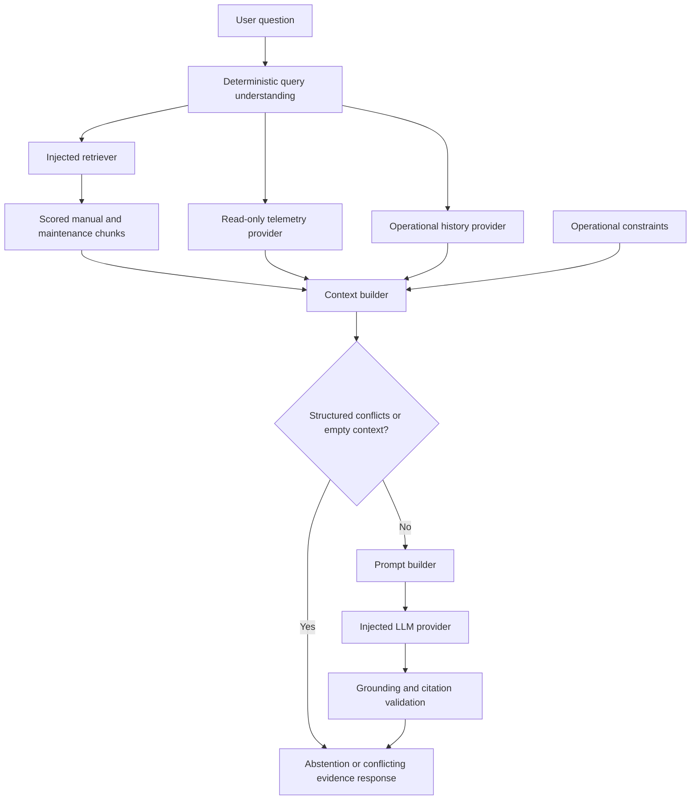

# BuildingMind AI v0.4 architecture

## Baseline and intent

The inspected baseline was commit `e71e7ff`, shared by `main`, `Development`, and
`v0.3`, with only README.md. The v0.4 work therefore creates the missing foundation
and an additive RAG layer. Compatibility with an earlier implementation cannot be
asserted because no earlier source, public API, or automated tests were available.

The system investigates building operations through read-only evidence. It separates
observed facts, reference/history excerpts, tentative hypotheses, and verification steps.

## Flow and boundaries

All boundary data uses immutable Pydantic v2 models with unknown fields forbidden and
nonfinite numeric fields rejected. Provider evidence and LLM drafts are revalidated
before use. Numeric readings arrive as strings to preserve source representation;
diagnostic rules separately reject nonnumeric/nonfinite readings.

| Package | Responsibility |
|---|---|
| `ingestion` | UTF-8 local documents, validation, revision-aware character chunks |
| `embeddings` | Provider protocol and deterministic lexical hash test double |
| `retrieval` | Retriever protocol, scored hits, atomic in-memory cosine index |
| `context` | Shared evidence/fact contracts, scope matching, historical provider |
| `telemetry` | Read-only provider protocol and deterministic measurement fixtures |
| `llm` | Provider contract, mock, lazy OpenAI adapter and explicit factory |
| `rag` | Query scope, bounded context, prompts, pipeline, rules, grounding, citations |

## Ingestion and retrieval foundation

`Document` carries a source ID, title, kind, exact text, floor, explicit equipment tags,
and optional structured facts. Source IDs are caller-owned stable identifiers.
`chunk_document` uses overlapping character windows with no text rewriting. Each chunk
retains zero-based character offsets with an exclusive end, and one-based inclusive
line numbers. IDs incorporate the complete document revision, metadata, and window
positions. A content or metadata revision produces different IDs.

Only facts whose entire quote fits inside a chunk survive chunking. A fact spanning
all windows can therefore be omitted; chunk size must suit the source material.

`EmbeddingProvider.embed` accepts a tuple of texts and returns one fixed-dimensional
finite vector per text. The index validates count, dimensions, finite values, and
identity collisions before atomic mutation. Equal evidence upserts are idempotent;
reusing an ID for different content fails. Zero vectors produce no positive matches.

Search uses normalized cosine scores, positive similarity, a configurable score
threshold (default 0.15), and top-k (default 5). Ties sort by evidence ID. Explicit floor
and equipment filters apply before selecting results; equipment tags match by
intersection. Providers must declare equipment relationships; none are inferred.

The supplied mock hashes lowercase tokens with SHA-256 into 1,024 dimensions. It
requires no download and is stable across processes. It has lexical limitations and
hash collisions; it is not evidence of production semantic retrieval quality.
The injected interface allows replacement with a learned embedding implementation.

## Evidence and context

`Evidence` includes a source identifier, revision-specific evidence ID, kind, exact
text, location, floor, equipment, optional timestamp, and structured facts.
Kinds are `telemetry`, `manual`, `maintenance`, and `history`.
Telemetry requires an aware timestamp and canonical fact text, including subject,
metric, value, and unit. Facts must quote their evidence verbatim. Document adapters
are responsible for accurate structured annotations; quotations alone do not prove
an annotation's semantic interpretation.

`ContextBuilder` processes telemetry, retrieval-ranked chunks, then operational
history. It validates provider channels, reapplies query scope, deduplicates equal IDs,
and rejects identity collisions. It excludes future telemetry and readings older than
900 seconds by default. Operational history is retained as historical context and is
never used as a current sensor reading.

The default 24,000-character evidence budget counts serialized evidence, including
provenance and array separators. Whole items are retained or omitted; no partial quote
rewriting occurs. This is an evidence budget, not a tokenizer-based total prompt limit.
Question text, instructions, constraints, and evidence-gap descriptions add overhead.
Budget omissions and absent telemetry, records, or history become explicit gaps.

The library clock defaults to current UTC. The offline example injects its fixed
fixture clock. Snapshot identity for diagnostic support requires exactly matching
measurement instants and floors; near-aligned real telemetry needs upstream alignment.

## Query and provider contracts

Query understanding recognizes one `Floor N` and explicit `AHU-N`/`VAV-NX-N` identifiers.
Questions need a floor or equipment ID; otherwise the pipeline abstains before calling
providers. Input is limited to 2,000 characters. Empty and multi-floor inputs raise
validation errors. Natural-language paraphrase resolution and intent classification
are outside this version's bounded parser.

Providers expose `read(query)`, `search(...)`, or `generate(prompt)`; no control or
write operations are available. The pipeline receives all providers and builders via
its constructor. Retrieval/evidence failures return `provider_error` without raw
exception payloads. Invalid question/configuration errors remain caller errors.

The mock LLM extracts complete evidence excerpts and selects supported rule candidates.
The optional OpenAI adapter lazily imports the SDK and requests an `AnswerDraft` using
structured output. Its model must be configured explicitly. It handles refusal,
incomplete output, schema errors, and service failures. Request timeouts and output
limits are bounded. Default client retries are disabled; injected clients retain their
own behavior. No SDK dependency, API key, or network call is required for core execution.

## Grounding and citations

The model can produce only observation excerpts, reference/history excerpts, and
hypothesis codes with evidence references. Free-form model recommendations and factual
prose do not enter the public response.

Citation validation resolves IDs exclusively against the context actually supplied.
It checks exact quoted text and computes source character/line locations. Complete
telemetry text must be preserved in observations. Non-telemetry belongs in
`historical_evidence`, whose citation kind distinguishes reference manuals from history.
Hypothesis support must also appear in cited observations. Unknown IDs, altered quotes,
wrong categories, or unsupported hypotheses fail closed to insufficient evidence.

Public hypothesis text and human verification steps are locally defined. The LLM may
select only candidates whose required measurements pass the diagnostic rules. Every
hypothesis evidence ID resolves to a citation. The response never calls a building tool.

These measures validate provenance and the bounded rule set, not arbitrary factual
entailment or source truth. Untrusted document instructions can appear as quoted source
data; they cannot introduce new public hypothesis types, recommendations, or actuations.
The mock injection test does not establish behavior of every real model.

## Diagnostic rules and response status

Both hypothesis types require one time-aligned snapshot containing:

1. Temperature above the same zone's setpoint, in °C.
2. An explicitly associated AHU running with supply-air temperature marked normal.
3. An associated VAV airflow deficit between 30% and 100%, inclusive.

This supports `airflow_restriction`, phrased as reduced air delivery that may limit
cooling. `damper_tracking_fault` additionally requires the same VAV's command and
actual position, within 0–100%, with actual below command by at least 20 percentage
points. These are demonstration thresholds and tentative hypotheses, not fault
confirmation. No trend of temperature increase is inferred from a single snapshot.

| Status | Meaning |
|---|---|
| `answered` | Supported tentative hypothesis plus cited manual/maintenance evidence |
| `insufficient_evidence` | Missing scope/evidence, unsupported diagnosis, or rejected generated answer |
| `conflicting_evidence` | Incompatible structured facts with citations to the alternatives |
| `provider_error` | Evidence provider or LLM failure/invalid boundary data |

Missing operational history is disclosed but does not alone prevent an otherwise
supported answer. Missing records prevent `answered`; any measurement-supported
hypotheses remain explicitly tentative. Missing critical measurements prevent the
corresponding rule. Unsupported fault classes abstain.

## Conflict handling

Facts compare by subject, metric, unit, and scope. Telemetry uses its observation
instant, normalized to UTC, as scope. Document facts use explicit caller-supplied scope
(e.g. an inspection ID). Equivalent decimal readings and case/whitespace variations
are normalized. Different timestamps do not automatically conflict.

Any detected structured conflict suppresses diagnostic hypotheses and bypasses the
LLM, preserving alternative values and their citations. It does not automatically
choose a newer record, infer prose contradictions, reconcile units, or judge source
reliability. Conflicts in evidence omitted by retrieval or the context budget cannot
be discovered by this pipeline.

## Remaining production work

Add persistent vector storage and learned embeddings, real read-only BMS/history
adapters, equipment relationship management, source revision lifecycle/removal, access
control, real-world retrieval evaluation, telemetry alignment and calibration, broader
diagnostic coverage, and domain-reviewed thresholds. A real API smoke test remains
optional and has not been run. The sample fixtures are synthetic and offer no production
accuracy estimate.
